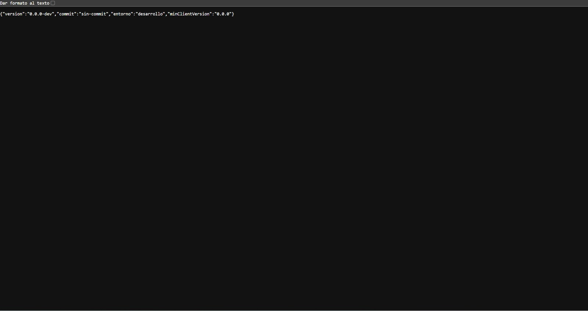

# A1.3: Acceso y entorno de desarrollo

**Alumnos:** Carlos Velasco Sala y Anass Belghiti

**Máquina:** dev.grupo3 (VM 119, Proxmox del instituto), IP 192.168.205.114 (DHCP), usuario `c27`

## Entorno

La práctica se hizo primero en un Proxmox local y después se repitió en el Proxmox del instituto. Este documento recoge lo hecho en el instituto. Las órdenes de cada apartado indican en qué máquina se ejecutaron.

## 1. Nombre de la máquina

En `dev.grupo3`:

```
sudo hostnamectl set-hostname dev.grupo3
sudo sed -i -E 's/^127\.0\.1\.1.*/127.0.1.1\tdev.grupo3 dev/' /etc/hosts
```

Resultado: `hostname` devuelve `dev.grupo3` y `sudo` ya no avisa de `unable to resolve host`.

## 2. Pares de claves

Carlos (Windows):

```
ssh-keygen -t ed25519
```

Anass (Mac):

```
ssh-keygen -t ed25519 -C "anass@grupo3"
```

Se usaron las rutas por defecto y sin passphrase.

## 3. Claves públicas en dev.grupo3

Carlos copió su clave desde PowerShell. Fue la única vez que se usó la contraseña de `c27`:

```
type $env:USERPROFILE\.ssh\id_ed25519.pub | ssh c27@192.168.205.114 "mkdir -p ~/.ssh && chmod 700 ~/.ssh && cat >> ~/.ssh/authorized_keys && chmod 600 ~/.ssh/authorized_keys"
```

La clave de Anass se añadió en `dev.grupo3`:

```
echo "ssh-ed25519 AAAAC3NzaC1lZDI1NTE5AAAAICQFpLhbgn2mG0kblD6UFgfU3Nh1kx7gXUAb9eMTVFkZ anass@grupo3" >> ~/.ssh/authorized_keys
ssh-keygen -lf ~/.ssh/authorized_keys
```

Salida:

```
256 SHA256:Xi3L7kizgD1asLXclNR6Eh/Y+R0ap4Vj/qMi0QyJ5w0 carlos@DESKTOP-SV5O6RJ (ED25519)
256 SHA256:/71V1LmlCdHlOmF8S0lDNxlIvQ8WUiuyGkCMFVySBd0 anass@grupo3 (ED25519)
```

Comprobación desde el PC de Carlos:

```
ssh c27@192.168.205.114
```

Resultado: entra sin contraseña.

Anass lo comprobó desde su Mac con `ssh c27@192.168.205.114`. En el registro de `dev.grupo3` consta su entrada con clave:

```
sudo journalctl -u ssh --no-pager | grep "Accepted publickey"
```

```
2026-11-12T16:17:59+01:00 dev.grupo3 sshd-session[13524]: Accepted publickey for c27 from 192.168.205.110 port 51923 ssh2: ED25519 SHA256:/71V1LmlCdHlOmF8S0lDNxlIvQ8WUiuyGkCMFVySBd0
```

## 4. Desactivar la contraseña en SSH

Antes de desactivarla se comprobó que la clave funcionaba. Además, la consola de Proxmox servía de acceso de reserva.

En `dev.grupo3`:

```
printf 'PasswordAuthentication no\nKbdInteractiveAuthentication no\n' | sudo tee /etc/ssh/sshd_config.d/00-sin-password.conf
sudo sshd -t && sudo systemctl reload ssh
sudo sshd -T | grep -E '^(passwordauthentication|kbdinteractiveauthentication|pubkeyauthentication) '
```

Salida:

```
pubkeyauthentication yes
passwordauthentication no
kbdinteractiveauthentication no
```

Comprobación desde el PC:

```
ssh c27@192.168.205.114
ssh -o PubkeyAuthentication=no -o PreferredAuthentications=password,keyboard-interactive c27@192.168.205.114
```

Resultado: la primera entra con clave y la segunda devuelve `Permission denied (publickey)`.

## 5. Instalación

En `dev.grupo3`:

```
sudo apt-get update
sudo apt-get install -y --no-install-recommends postgresql nodejs npm git curl ca-certificates
```

Versiones: Node 20.19.2, npm 9.2.0 y PostgreSQL 17.11.

## 6. Clonado y base de datos

En `dev.grupo3`:

```
git clone https://github.com/esrora/tablon-avisos.git
cd /tmp
sudo -u postgres psql -v ON_ERROR_STOP=1 -c "CREATE ROLE tablon LOGIN PASSWORD '<la de api/.env.example>';"
sudo -u postgres createdb tablon --owner=tablon
cd ~/tablon-avisos
psql -v ON_ERROR_STOP=1 -h localhost -U tablon -d tablon -f db/init.sql
```

La contraseña del rol `tablon` es la que trae `api/.env.example`, válida solo para desarrollo. `init.sql` se ejecuta con el usuario `tablon` porque `postgres` no puede leer dentro de `/home/c27`.

Resultado: tabla `avisos` creada con 3 avisos de ejemplo.

## 7. Arranque de la API

En `dev.grupo3`:

```
cd ~/tablon-avisos/api
cp .env.example .env
npm install
nohup node --env-file=.env server.js > ~/api.log 2>&1 &
```

Salida de `~/api.log`:

```
Base de datos disponible
API del tablon escuchando en el puerto 3000
Version 0.0.0-dev (sin-commit) en entorno desarrollo
```

Comprobación desde el navegador del PC:

- `http://192.168.205.114:3000/api/version`: `{"version":"0.0.0-dev","commit":"sin-commit","entorno":"desarrollo","minClientVersion":"0.0.0"}`
- `http://192.168.205.114:3000/api/avisos`: devuelve los 3 avisos de ejemplo.

## 8. Captura de /api/version


